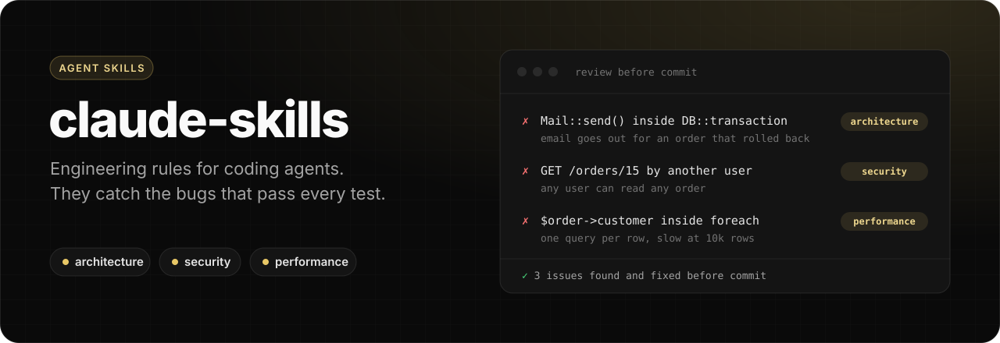
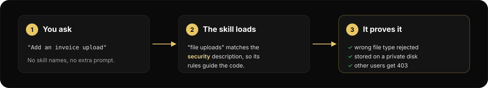

<p align="center">
  
</p>

<p align="center">
  <a href="#install"></a>
  <a href="https://agentskills.io"></a>
  <a href="LICENSE"></a>
</p>

The rules I give my coding agent, so it writes code the way I review it.
Works with Claude Code, Cursor, Codex and any agent that reads
[Agent Skills](https://agentskills.io).

## What it catches

| The bug | What happens | Skill |
|---|---|---|
| Email sent inside `DB::transaction` | The customer gets "order placed" for an order that rolled back | `architecture` |
| Coupon read, checked, then saved | Two requests use the same coupon | `architecture` |
| Double-click on "Pay" | Two orders, two charges | `architecture` |
| `/orders/15` not scoped to its owner | Any user reads any order | `security` |
| `$request->all()` passed to `create` | A user sets `is_admin = true` | `security` |
| Webhook without a signature check | Anyone can mark an order as paid | `security` |
| `$order->customer` inside `foreach` | One query per row; the page dies at 10k rows | `performance` |
| `->get()` on a growing table | The whole table loads into memory | `performance` |
| Money stored as `float` | Invoices are off by a cent, and totals don't match | `database-design` |
| Order line reads the product's current price | Old invoices change when the price changes | `database-design` |

## How it works

<p align="center">
  
</p>

Every skill ends with a **Before You Call It Done** checklist: the tests to
write and the greps to run, so the agent proves the rules instead of assuming
them.

## The skills

| | Covers |
|---|---|
| **[`architecture`](skills/architecture/SKILL.md)**<br>where code lives | Thin controllers and a service layer · transaction vs queue · race conditions and row locks · idempotent writes · status state machines |
| **[`security`](skills/security/SKILL.md)**<br>what crosses a trust boundary | IDOR · mass assignment · tenancy · rate limiting · XSS · uploads · webhooks · tests, errors, logging, migrations, API stability |
| **[`performance`](skills/performance/SKILL.md)**<br>what code costs at runtime | N+1 and eager loading · indexes that match real queries · pagination · cache invalidation · queues · memory |
| **[`database-design`](skills/database-design/SKILL.md)**<br>the shape of the data | Money types · price snapshots · foreign keys and delete rules · soft deletes vs unique · enums · UTC · public IDs · zero-downtime migrations |
| **[`code-audit`](skills/code-audit/SKILL.md)**<br>runs them all on a change | Audits a PR, a branch or a junior's code against these standards · verdict, blockers, should-fix, suggestions · file, line, scenario and fix · teaching mode |

Principles are language-agnostic, with exact Laravel APIs where it matters.
The four rule skills don't overlap; each points to the others. `code-audit`
adds no rules of its own: it's the process and the report format that runs
them together.

In Claude Code, use it alongside the built-in `/code-review`: that one hunts
bugs, `code-audit` checks these standards and can teach.

Try it: *"Audit this branch with the code-audit skill."*

## Install

**Claude Code**

```bash
/plugin marketplace add mgamalhz/claude-skills
/plugin install engineering@mgamalhz
```

**Any agent**, via [skills.sh](https://skills.sh)

```bash
npx skills add mgamalhz/claude-skills
```

**Manually:** copy a folder from `skills/` into `~/.claude/skills/` (every
project) or `.claude/skills/` (one project).

<details>
<summary><b>Make the review run on every commit</b></summary>

<br>

Skills load when the task matches their description. To run all three before
every commit, add this to your `CLAUDE.md`:

```markdown
## Review Before Commit
- Before any commit that changes code, load the `architecture`, `security` and
  `performance` skills, review the change against each one, and run the checks
  in their "Before You Call It Done" sections for the parts the change touches.
  Report what was verified and what wasn't.
```

</details>

<details>
<summary><b>See the fix for each example</b></summary>

<br>

```php
// architecture: send the email after the commit, never inside it.
DB::transaction(fn () => $order->save());
Mail::to($order->user)->queue(new OrderPlaced($order));

// architecture: one atomic update; the row count tells you who won.
$won = Coupon::whereKey($id)->where('used', false)->update(['used' => true]);

// security: load the record through its owner.
$order = $request->user()->orders()->findOrFail($id);

// security: only validated fields reach the model.
User::create($request->validated());

// performance: two queries, in pages.
Order::with('customer')->paginate();
```

</details>

## License

MIT
